# Actividades

## 1. Administradores de esquemas

**Enunciado literal (Universidad Católica de Santa María, s.f., p. 25):**

Implementar el código compartido en la sección “Administradores de Esquemas” para ver como funcionan los tipos de administradores de esquemas FlowLayout, BorderLayout y GridLayout. Para la implementación de cada uno de los administradores de esquema cambie el título de las ventanas para que aparezcan los integrantes de su grupo que han participado. Haga capturas de pantalla por cada implementación de administrador de esquema de tal forma que se evidencie cómo organiza el contenido.

**Entorno de trabajo:** revisión con Visual Studio Code 1.145.0 y Java 21.0.12.1. El programa se compila para Java 17. Las versiones se comprobaron con los comandos del editor y de Java; sus salidas están en `pruebas/versiones_comprobadas.txt`.

**Archivo:** `codigos/lab09/LayoutsFrame.java`. Los tres esquemas se construyen en una misma clase y se abren desde `codigos/lab09/Main.java`. Los títulos muestran a Ancco Flores, Sebastian Jhon; Ortiz Condori, Herbert Rodrigo; y Cayani Poma, Fernando. Se usan los mismos nombres del cuadro inicial. `SwingUtilities.invokeLater` prepara la ventana en el hilo que Swing usa para atender los eventos, como los clics y las selecciones.

### A) FlowLayout

Se agregan seis botones en orden, con alineación a la izquierda y separaciones entre componentes. El método utilizado es:

```java
private static void configurarFlow(JPanel panel) {
    panel.setLayout(new FlowLayout(FlowLayout.LEFT, 10, 12));
    for (int indice = 1; indice <= 6; indice++) {
        JButton boton = crearBoton("Botón " + indice, "flowBoton" + indice, AZUL);
        boton.setPreferredSize(new Dimension(135, 48));
        boton.setToolTipText("FlowLayout: conserva su tamaño "
                + "y pasa a otra fila si falta espacio.");
        panel.add(boton);
    }
}
```

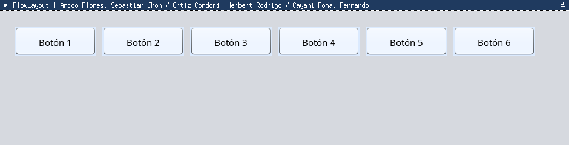

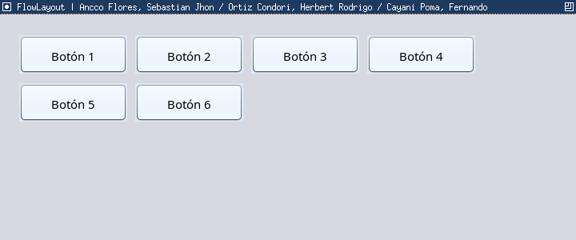

**Descripción:** FlowLayout coloca los componentes de izquierda a derecha según el orden de incorporación (Oracle, s.f.-a). Cuando se reduce el ancho de la ventana, los botones que ya no caben pasan a otra fila. El tamaño preferido de cada botón se conserva y el orden continúa siendo el mismo.

### B) BorderLayout

Se utiliza un botón en cada región: norte, sur, oeste, este y centro.

```java
private static void configurarBorder(JPanel panel) {
    panel.setLayout(new BorderLayout(10, 10));
    panel.add(crearBoton("NORTE · NORTH", "borderNorte", AZUL), BorderLayout.NORTH);
    panel.add(crearBoton("SUR · SOUTH", "borderSur", AZUL), BorderLayout.SOUTH);
    panel.add(crearBoton("OESTE · WEST", "borderOeste", AMBAR), BorderLayout.WEST);
    panel.add(crearBoton("ESTE · EAST", "borderEste", AMBAR), BorderLayout.EAST);
    panel.add(crearBoton("CENTRO · CENTER", "borderCentro", VERDE), BorderLayout.CENTER);
}
```

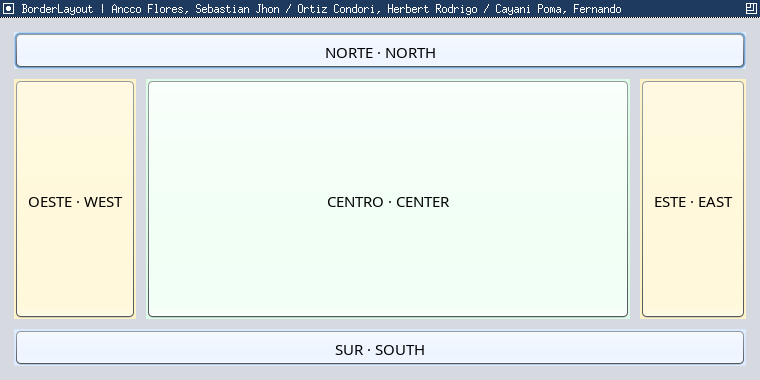

**Descripción:** norte y sur ocupan el ancho disponible. Entre ambas regiones se ubican oeste y este, mientras que el centro recibe el espacio restante (Oracle, s.f.-a). Para incorporar varios controles en una región se puede colocar un JPanel dentro de ella.

### C) GridLayout

La cuadrícula tiene dos filas y tres columnas de igual tamaño.

```java
private static void configurarGrid(JPanel panel) {
    panel.setLayout(new GridLayout(2, 3, 10, 10));
    for (int indice = 1; indice <= 6; indice++) {
        int fila = (indice - 1) / 3 + 1;
        int columna = (indice - 1) % 3 + 1;
        JButton boton = crearBoton(
                "<html><center>Botón " + indice + "<br>Fila " + fila
                        + " · Columna " + columna + "</center></html>",
                "gridBoton" + indice, indice % 2 == 0 ? AZUL : VERDE);
        boton.setToolTipText("GridLayout: todas las celdas tienen el mismo tamaño.");
        panel.add(boton);
    }
}
```

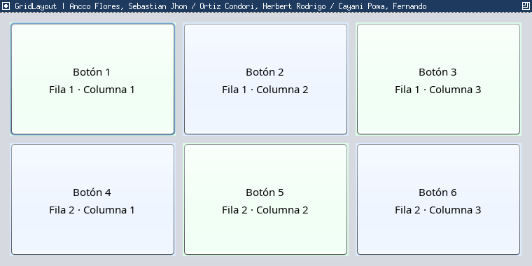

**Descripción:** GridLayout distribuye los controles de izquierda a derecha y continúa en la siguiente fila. Todos reciben el mismo ancho y alto (Oracle, s.f.-a).

| Administrador | Distribución | Uso habitual |
|---|---|---|
| FlowLayout | Componentes en secuencia; pasan de fila al faltar espacio | Grupos sencillos de botones |
| BorderLayout | Cinco regiones; el centro recibe el espacio restante | Ventana con cabecera, contenido y pie |
| GridLayout | Filas y columnas con celdas iguales | Teclados, tableros y conjuntos regulares |

# Ejercicios

## 1. Diseño visual de una GUI Swing

**Enunciado literal (Universidad Católica de Santa María, s.f., pp. 25–26):**

Investigue en el IDE de su preferencia cómo se puede utilizar herramientas visuales que permitan crear componentes GUI Swing a través de operaciones “soltar y arrastrar” realizadas con el mouse de tal manera que sólo se tenga que agregar código a las clases y manejadores ya creados de manera automática por el IDE. Explique brevemente lo siguiente:

### a. Como es el proceso de creación de una GUI utilizando herramientas de “soltar y arrastrar” y haga capturas de pantalla que evidencien el mismo.

VS Code admite el desarrollo de aplicaciones gráficas Java (Microsoft, s.f.). En esta práctica se utiliza **Visual Studio Code 1.145.0** con la extensión **Swing GUI Builder 0.0.3**, de gugacarbo. La extensión agrega una paleta, un lienzo y un panel de propiedades; permite generar clases Java Swing y el enlace a un método de evento (Carbonera, s.f.). Este diseñador es un complemento de VS Code.

En las figuras 8 a 10, el Explorer muestra el nombre local `entrega`. Es el mismo proyecto que se publica en la raíz del repositorio `lp3_guia09`, con las mismas rutas internas.

1. Abrir la carpeta raíz `lp3_guia09` en VS Code. En **Extensions** (Ctrl+Shift+X), buscar **Swing GUI Builder**, de Gustavo Carbonera (identificador `gugacarbo.swing-gui-builder`), e instalarlo. En la captura aparecen las opciones de administración de la extensión instalada y su versión.

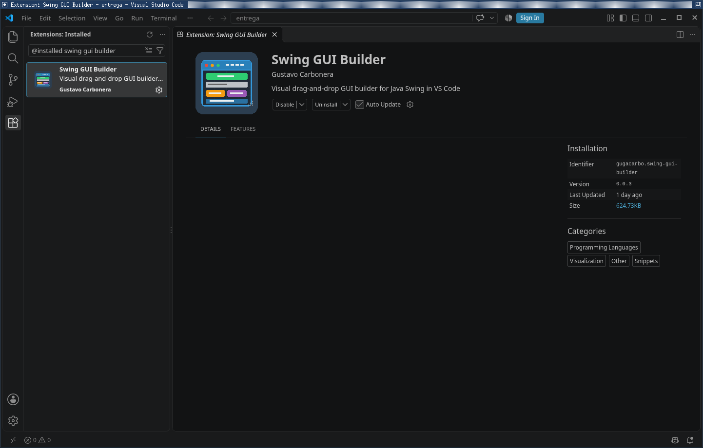

2. Presionar Ctrl+Shift+P, buscar **Swing GUI Builder: New Window** y seleccionar el comando. Escribir un nombre para la ventana. Así se abre el diseñador antes de colocar componentes.

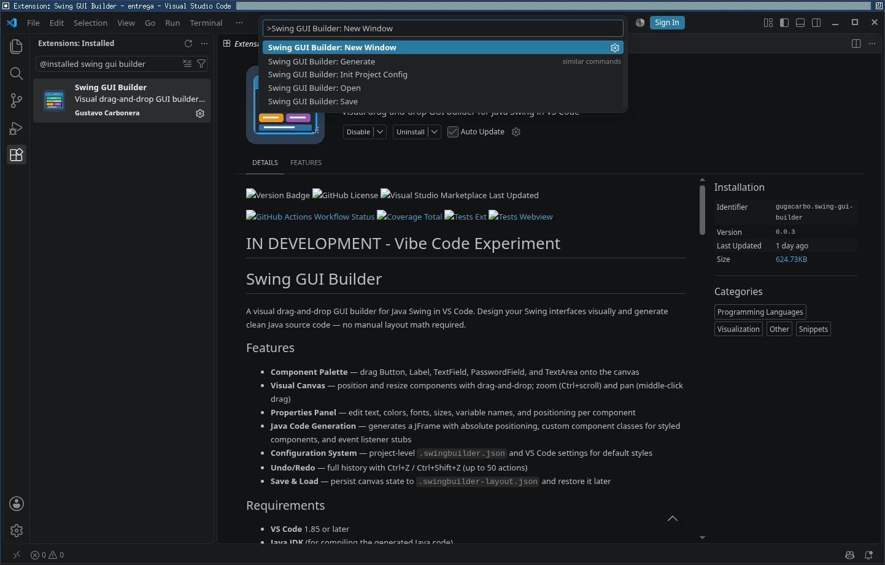

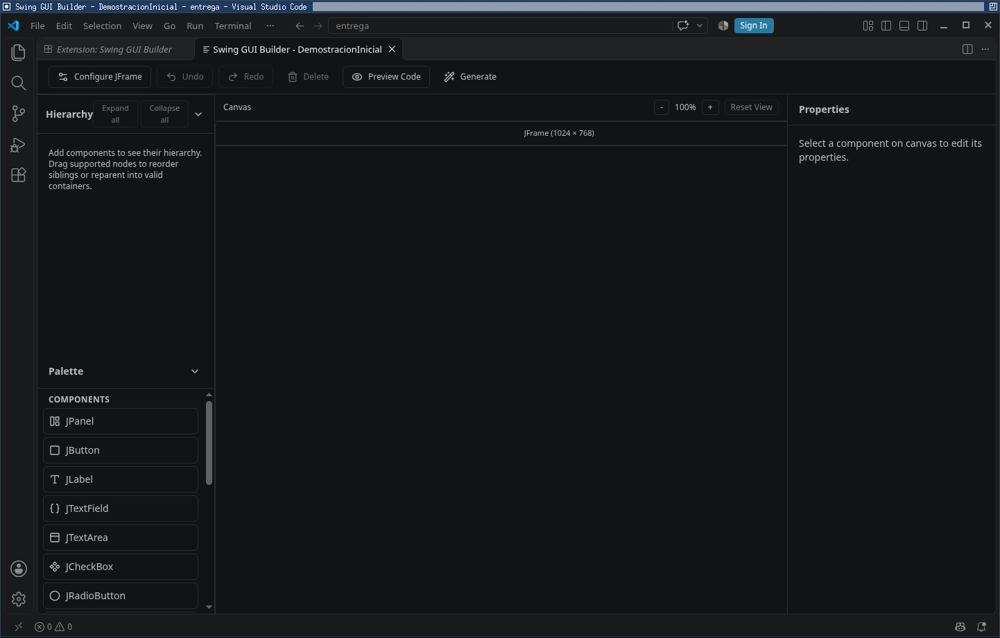

La figura 7 muestra el lienzo abierto con el nombre provisional `DemostracionInicial`. Para el diseño y la exportación final se utiliza `MainWindow`, visible desde la figura 8; ese es también el nombre de la clase Java ejecutable.

3. En **Configure JFrame**, establecer un tamaño de 820 × 330 y el título con los nombres de los tres integrantes. Arrastrar JLabel, JTextField y JButton desde la paleta al lienzo. Configurar los textos “Nombre:”, “Sebastian Jhon” y “Saludar”.
4. Seleccionar el botón y escribir `mostrarSaludo` en **Event Method**. Guardar con **Swing GUI Builder: Save**. El archivo `.swingbuilder-layout.json` conserva las posiciones y las propiedades para volver a abrir el diseño. En ese archivo, editar `variableName` de los tres componentes para usar `etiquetaNombre`, `campoNombre` y `botonSaludar`; guardar y reabrir el diseño. La versión 0.0.3 no ofrece ese cambio de nombre en el panel Properties.

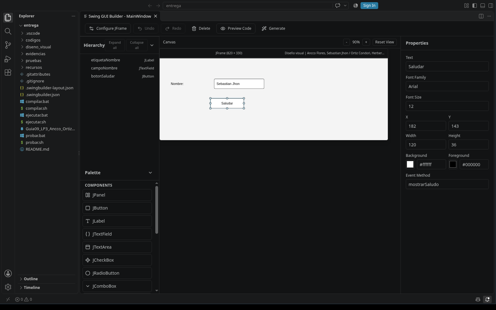

5. Pulsar **Generate** y elegir `diseno_visual` como carpeta de salida. Se generan `MainWindow.java`, `CustomLabel1.java`, `CustomTextField1.java` y `CustomButton1.java`. Se renombraron las variables en el diseño guardado y se regeneró el código con los identificadores descriptivos.
6. Abrir `MainWindow.java`. El generador crea los controles, sus posiciones, el enlace del botón y el método `mostrarSaludo`. Completar ese método para leer el campo, comprobar que tenga un nombre y mostrar el diálogo.

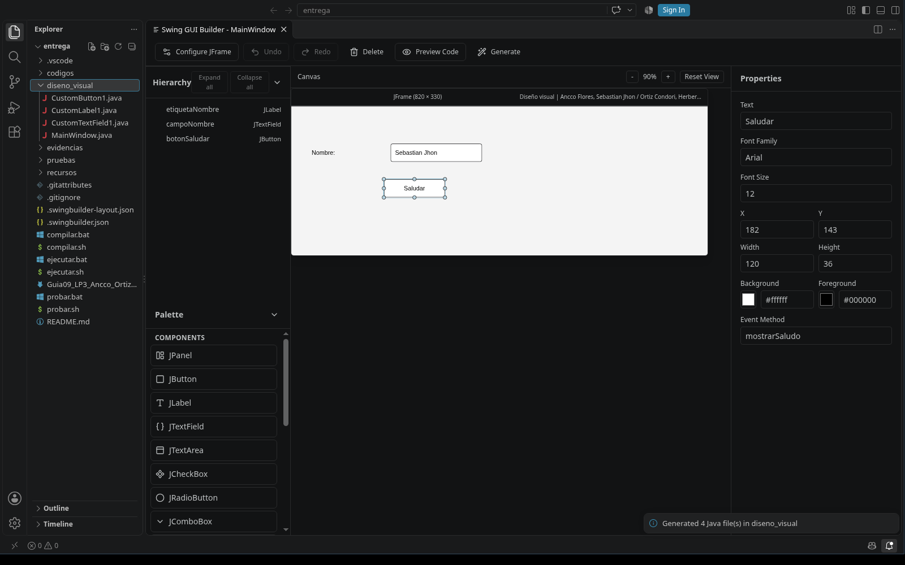

**Archivo:** `diseno_visual/MainWindow.java`. Código del manejador completado:

```java
private void mostrarSaludo() {
  String nombre = campoNombre.getText().strip();
  if (nombre.isEmpty()) {
    JOptionPane.showMessageDialog(this, "Ingrese su nombre.");
    return;
  }
  JOptionPane.showMessageDialog(this,
      "Hola, " + nombre + ". Bienvenido a Java Swing.",
      "Saludo", JOptionPane.INFORMATION_MESSAGE);
}
```

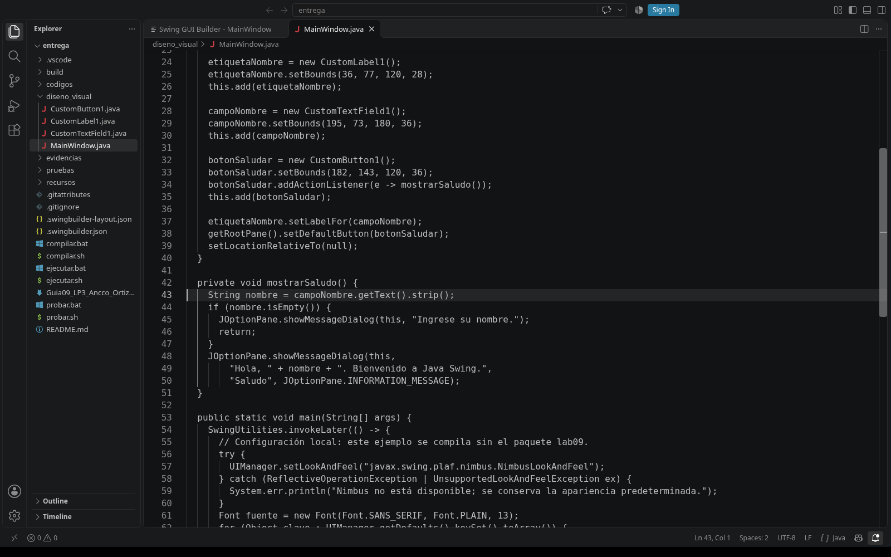

También se añadieron los comentarios con los nombres y códigos del equipo, el identificador de versión de la clase, la relación entre etiqueta y campo, el botón predeterminado para Enter y el centrado de la ventana. En `main` se configuraron la apariencia Nimbus y la fuente. Esta configuración quedó dentro de `MainWindow`, por lo que la demostración no depende del paquete `lab09` ni del formulario de pasajes.

7. Compilar y ejecutar la demostración por separado:

```text
javac --release 17 -encoding UTF-8 -d build/visual diseno_visual/*.java
java -cp build/visual MainWindow
```

La compilación aislada de los cuatro archivos fue correcta. El registro está en `pruebas/verificacion_independencia.txt`. Al pulsar Saludar con un nombre aparece el saludo; con el campo vacío, el programa pide completarlo.

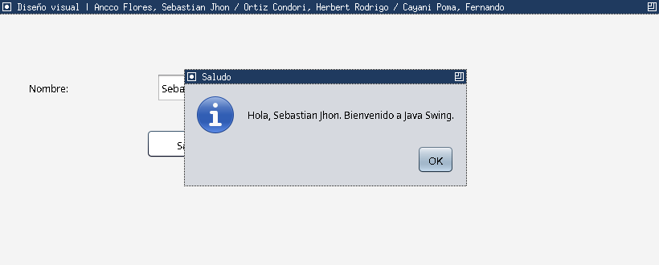

**Descripción:** `getText()` obtiene lo escrito y `strip()` quita los espacios al comienzo y al final. JOptionPane muestra el mensaje. El diseñador ahorra escribir la creación y colocación de los controles; la acción del botón se completa mediante código.

Este generador coloca los controles con `setLayout(null)` y `setBounds`, por lo que el ejemplo tiene una distribución fija. En el formulario de pasajes se usan administradores de esquemas para organizar los paneles. Antes de generar de nuevo conviene guardar una copia del manejador, porque el generador puede reemplazar el archivo Java.

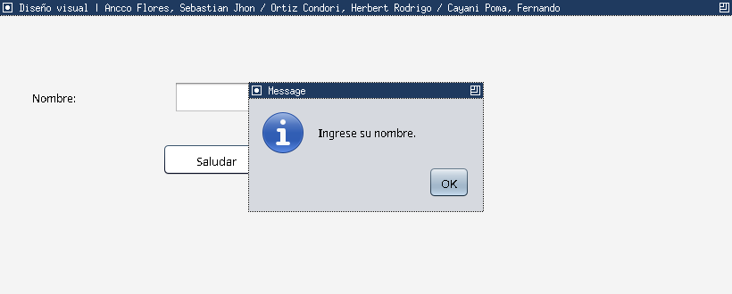

La captura del aviso corresponde al segundo caso comprobado por `PruebasVisual.java`.

### b. Cuáles serían algunas ventajas y desventajas de crear una GUI desde código y de hacerlo con una herramienta de “soltar y arrastrar”

| Método | Ventajas | Desventajas |
|---|---|---|
| Programar desde código | Control directo de layouts y eventos; permite componentes dinámicos; facilita revisar los cambios | Requiere más escritura y conocer los administradores para alinear correctamente los controles |
| Arrastrar y soltar | Agiliza la colocación de controles; permite revisar la distribución visual; genera inicialización y enlaces de eventos | La extensión se declara en desarrollo; depende de sus archivos de diseño, puede generar código más extenso y utiliza posiciones absolutas. Conviene revisar el resultado y conservar copias del código |

**Descripción:** ambas alternativas requieren programar la lógica de la aplicación. La herramienta visual facilita construir la interfaz, pero las validaciones y las acciones del programa deben definirse mediante código.

## 2. Aplicación para la compra de pasajes

**Enunciado literal (Universidad Católica de Santa María, s.f., p. 26):**

Implemente una pequeña aplicación que simule el ingreso de datos para la compra de pasajes de una empresa de transporte terrestre. Para esto deberá utilizar todos los conceptos y componentes ya vistos. Una vez que se ingresen todos los datos del pasajero, se deberá mostrar un resumen de sus datos en un cuadro de Dialogo luego de presionar un botón. A continuación, se muestran cómo se utilizarían los componentes para ingresar un tipo de información específica:

| Nombre de Componente | Propósito que cumplira en la GUI de compra de pasaje |
|---|---|
| Etiquetas | Rotular que tipo de información se ingresara en cada componente |
| Campos de Texto | Ingreso de nombres, documento de identidad y fecha de viaje |
| Botón de Comando | Reiniciar o blanquear todos los componentes y mostrar diálogo |
| Casillas de Verificación | Indicar servicio opcional para pasajero (audifonos, manta, revistas) |
| Botones de Opción | Indicar si el pasajero quiere viajar en 1er o 2do piso |
| Cuadros combinados | Permitir al pasajero elegir un lugar de origen y de destino |
| Lista | Elegir entre 3 calidades de servicio (económico, standard, VIP) |

### A) Componentes utilizados

Estos controles de Swing recogen los datos y ejecutan las acciones del formulario (Oracle, s.f.-b).

| Componente de la guía | Control implementado | Información o acción |
|---|---|---|
| Etiquetas | JLabel | Rótulos de nombres, DNI, fecha, ciudades, piso y servicios |
| Campos de texto | JTextField: nombres, documento, fecha | Nombres y apellidos, documento y fecha de viaje |
| Botones de comando | JButton: limpiar, resumen | Borrar el formulario y mostrar el diálogo |
| Casillas de verificación | JCheckBox: audifonos, manta, revistas | Seleccionar libremente los servicios adicionales |
| Botones de opción | JRadioButton y ButtonGroup | Elegir únicamente primer o segundo piso |
| Cuadros combinados | JComboBox: origen, destino | Elegir las ciudades de partida y llegada |
| Lista | JList: servicio | Elegir Económico, Standard o VIP; selección única |

**Archivos:** `codigos/lab09/PasajesFrame.java` contiene el formulario; `codigos/lab09/Pasaje.java` valida y conserva los datos. `codigos/lab09/Estilo.java` configura la apariencia Nimbus y una fuente común. Nimbus cambia cómo se ven los controles, sin cambiar lo que hace el programa. `Main.java` ofrece el menú para abrir las demostraciones y el formulario.

El formulario se divide en paneles. BorderLayout separa la cabecera, los datos y los botones; GridLayout ordena las opciones. Como apoyo se usa GridBagLayout para colocar una etiqueta y su campo en cada fila: permite que el rótulo tenga poco ancho y que el campo aproveche el espacio restante al cambiar el tamaño de la ventana. Los paneles JPanel reúnen estos grupos de controles. La lista muestra las tres calidades de servicio. Los botones de piso pertenecen a un ButtonGroup y las casillas adicionales se pueden marcar de forma independiente.

### B) Lectura de datos y resumen

**Archivo:** `codigos/lab09/PasajesFrame.java`. El botón Mostrar resumen invoca este método:

```java
private void mostrarResumen() {
    List<String> opcionales = new ArrayList<>();
    if (audifonos.isSelected()) {
        opcionales.add("Audífonos");
    }
    if (manta.isSelected()) {
        opcionales.add("Manta");
    }
    if (revistas.isSelected()) {
        opcionales.add("Revistas");
    }
    try {
        Pasaje pasaje = Pasaje.crear(nombres.getText(), documento.getText(), fecha.getText(),
                (String) origen.getSelectedItem(), (String) destino.getSelectedItem(),
                pisos.getSelection() == null ? null : pisos.getSelection().getActionCommand(),
                servicio.getSelectedValue(), opcionales);
        JOptionPane.showMessageDialog(this, pasaje.resumen(), "Resumen del pasaje",
                JOptionPane.INFORMATION_MESSAGE);
        estado.setText("Resumen mostrado. Puede editar los datos "
                + "o iniciar una nueva solicitud con Limpiar.");
    } catch (IllegalArgumentException ex) {
        JOptionPane.showMessageDialog(this, ex.getMessage(), "Revise los datos",
                JOptionPane.WARNING_MESSAGE);
        estado.setText("Corrija los datos indicados y vuelva a pulsar Mostrar resumen.");
    }
}
```

**Descripción:** se crea una lista con los adicionales marcados y se leen los campos, las ciudades, el piso y la calidad. `Pasaje.crear(...)` valida la solicitud. Si todo es correcto, JOptionPane presenta el resumen; si una regla falla, el bloque catch muestra una advertencia y conserva los datos para corregirlos.

### C) Validación de los datos

La guía no impone un tipo de documento. Para esta implementación se adopta DNI peruano de ocho dígitos y se informa esta decisión en el propio formulario.

| Dato | Validación |
|---|---|
| Nombres | Obligatorios; letras Unicode, acentos, espacios, guiones y apóstrofos |
| DNI | Exactamente ocho dígitos; se conserva como texto para no perder ceros iniciales |
| Fecha | Formato dd/MM/yyyy, día existente y fecha actual o futura |
| Ruta | Ciudades disponibles y origen diferente del destino |
| Piso y calidad | Selección obligatoria; un piso y una calidad |
| Adicionales | Se permite ninguno, uno, dos o los tres servicios |

**Archivo:** `codigos/lab09/Pasaje.java`. El formato de fecha se comprueba de esta manera:

```java
private static final DateTimeFormatter FECHA =
        DateTimeFormatter.ofPattern("dd/MM/uuuu")
                .withResolverStyle(ResolverStyle.STRICT);
```

**Descripción:** el analizador rechaza fechas que no existen, por ejemplo 31/11/2026. El DNI se guarda como String para conservar los ceros iniciales. Los opcionales se copian al crear la solicitud; cambiar después otra lista no altera el resumen. Estas reglas pueden probarse sin abrir ventanas.

### D) Reinicio de todos los componentes

**Archivo:** `codigos/lab09/PasajesFrame.java`. Código del método de limpieza:

```java
public void limpiarFormulario() {
    nombres.setText("");
    documento.setText("");
    fecha.setText("");
    origen.setSelectedIndex(-1);
    destino.setSelectedIndex(-1);
    pisos.clearSelection();
    servicio.clearSelection();
    audifonos.setSelected(false);
    manta.setSelected(false);
    revistas.setSelected(false);
    estado.setText(AYUDA);
    nombres.requestFocusInWindow();
}
```

**Descripción:** el método borra los textos, deja ambos combos sin selección, elimina la elección de piso y calidad, desmarca los tres adicionales y devuelve el foco al nombre. El botón Limpiar y el atajo Ctrl+L invocan la misma acción.

### E) Eventos, adaptadores y teclado

Al pulsar un botón, su ActionListener ejecuta la acción correspondiente. Los combos actualizan la ruta seleccionada. MouseAdapter cambia la ayuda al pasar el puntero por el botón de resumen y WindowAdapter coloca el cursor en el nombre al abrir la ventana. Como facilidades adicionales, Enter o Alt+R muestran el resumen y Ctrl+L limpia el formulario; las ayudas emergentes explican qué ingresar.

### F) Prueba de ejecución

Se ingresaron estos datos ficticios: **Ana Lucía Pérez**, DNI **01234567**, fecha **17/12/2026**, ruta **Arequipa–Lima**, **2do piso**, calidad **VIP**, con **Audífonos, Manta y Revistas**.

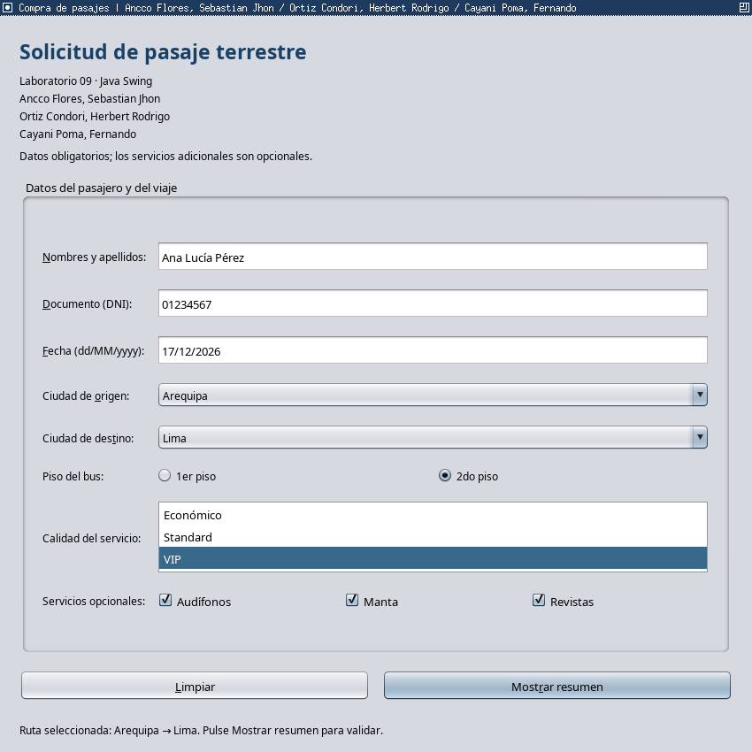

**Descripción:** las casillas permiten elegir varios adicionales; el piso y la calidad tienen selección única. El DNI mantiene el cero inicial. Los títulos identifican a los tres integrantes.

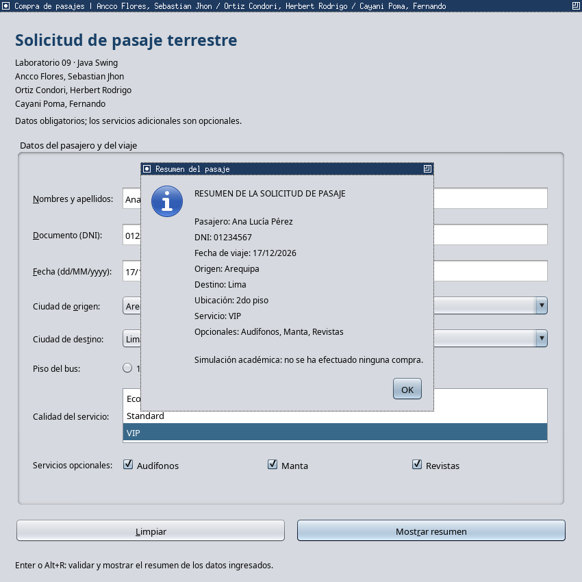

**Descripción:** al pulsar Mostrar resumen, el diálogo presenta los mismos valores del formulario. Es una simulación de ingreso de datos, sin pagos ni reservas reales.

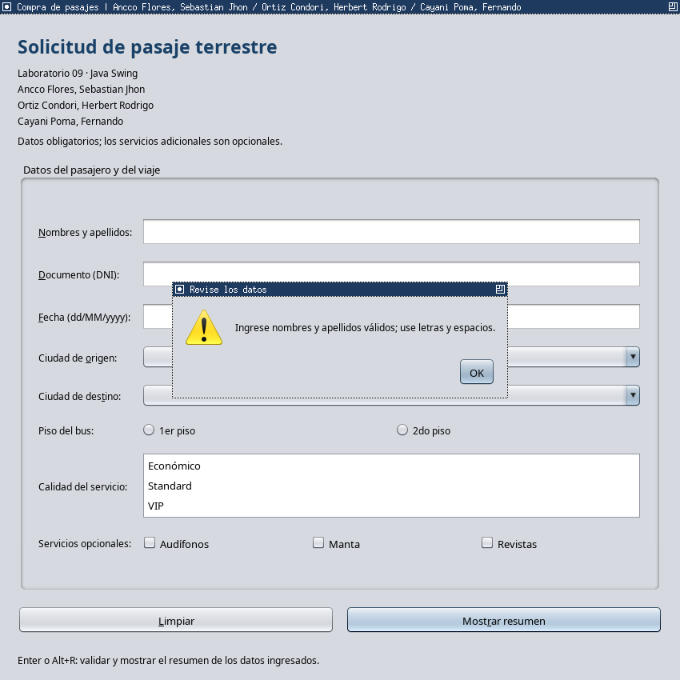

**Descripción:** la aplicación muestra el motivo del error y permite completar la información sin cerrarse.

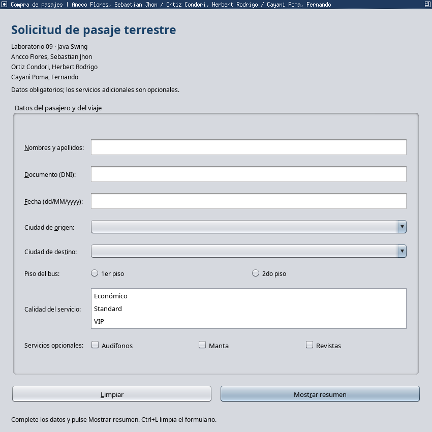

**Descripción:** se vacían nombres, DNI y fecha; se eliminan las selecciones de ruta, piso y calidad; y se desmarcan los adicionales.

## 3. Comprobaciones y archivos de entrega

| Comprobación | Resultado y evidencia |
|---|---|
| Modelo de datos | 81 comprobaciones correctas; `pruebas/resultado_modelo.txt` |
| Interfaz de layouts y pasajes | 20 comprobaciones correctas; `pruebas/resultado_interfaz.txt` |
| Formulario visual generado | 2 comprobaciones correctas; `pruebas/resultado_visual.txt` |
| Compilación del proyecto | Java 17 y UTF-8; correcta sin advertencias. Registro: `pruebas/verificacion_compilacion.txt` |
| Versiones del entorno | VS Code, Java, javac y extensión comprobados. Registro: `pruebas/versiones_comprobadas.txt` |
| Ejemplo visual independiente | Los cuatro archivos compilan sin el paquete principal. Registro: `pruebas/verificacion_independencia.txt` |
| Enlaces y repositorio | Registros de las comprobaciones: `pruebas/enlaces_comprobados.txt` y `pruebas/repositorio_publico.txt` |

Las pruebas del modelo incluyen nombres y DNI inválidos, fechas inexistentes y pasadas, rutas iguales, selecciones obligatorias y las ocho combinaciones de adicionales con las tres calidades. Las pruebas gráficas comprueban distribución de layouts, exclusión de pisos, resumen, advertencia y limpieza. Las capturas reales se obtuvieron automáticamente con `java.awt.Robot`, una clase de Java que permite simular clics y pulsaciones y capturar la pantalla durante las pruebas. Se usa para verificar las ventanas; no forma parte de la compra de pasajes. La prueba gráfica usa una fecha futura calculada al ejecutarla; el registro indica el valor utilizado.

### Archivos de código e integrantes

Todos los archivos Java incluyen los nombres y códigos de los tres integrantes. Los nombres se escriben igual en el cuadro inicial, los títulos y los comentarios del código: **Sebastian Jhon Ancco Flores**, **Herbert Rodrigo Ortiz Condori** y **Fernando Cayani Poma**.

| Archivo | Función |
|---|---|
| codigos/lab09/Main.java | Punto de entrada y menú de demostraciones |
| codigos/lab09/LayoutsFrame.java | FlowLayout, BorderLayout y GridLayout |
| codigos/lab09/PasajesFrame.java | Formulario Swing, eventos, resumen y limpieza |
| codigos/lab09/Pasaje.java | Validación y resumen de la solicitud |
| codigos/lab09/Estilo.java | Apariencia Nimbus y fuente común |
| diseno_visual/MainWindow.java | JFrame generado y evento de saludo completado |
| diseno_visual/CustomLabel1.java | Etiqueta generada por el diseñador |
| diseno_visual/CustomTextField1.java | Campo de texto generado por el diseñador |
| diseno_visual/CustomButton1.java | Botón generado por el diseñador |

La carpeta raíz `lp3_guia09` incluye `codigos/`, `diseno_visual/`, `pruebas/`, `evidencias/`, los archivos JSON del diseñador, la configuración de tareas de VS Code y el ejecutable. El repositorio del proyecto es [Nachok20/lp3_guia09](https://github.com/Nachok20/lp3_guia09). El manifiesto `SHA256SUMS.txt` permite cotejar las sumas de los archivos de la entrega. `README.md` explica cómo abrir el proyecto y repetir la práctica. Para iniciar el menú, desde la carpeta raíz se puede ejecutar:

```text
java -jar Guia09_LP3.jar
```

## 4. Cuadro de la rúbrica de la Guía 09

Se conserva la escala de la guía para que el docente pueda evaluar la entrega. Los valores indican los máximos de cada nivel; no representan una nota asignada.

| Criterio | A | B | C | D | NP |
|---|---|---|---|---|---|
| R1. Uso de estándares y buenas prácticas de programación | 2 | 1.5 | 1 | 0.5 | 0 |
| R2. Manejo y uso adecuado de componentes Swing | 4 | 2 | 1.5 | 0.5 | 0 |
| R3. Informe detallado, bien redactado y ordenado con las respuestas y evidencias de las actividades. | 6 | — | — | — | 0 |
| R4. Resolución de los ejercicios donde se hace uso adecuado de componentes y conceptos para crear las GUI solicitadas según sea el caso. Mostrar evidencia suficiente. | 8 | — | — | — | 0 |
| Total máximo | 20 | | | | |

**Correspondencia:** R1 se evidencia en las responsabilidades de las clases, nombres, validaciones y uso del hilo de eventos; R2, en la tabla de controles y el código Swing; R3, en el desarrollo de layouts con código, capturas y descripción; y R4, en el diseñador visual y la aplicación de pasajes con sus pruebas.

# Conclusiones

1. FlowLayout reorganiza los componentes en filas, BorderLayout distribuye cinco regiones y GridLayout conserva celdas uniformes. Las capturas muestran el comportamiento de cada esquema.
2. El complemento de VS Code permite construir un formulario visual y generar Java. El programador completa el manejador para leer los datos, validarlos y mostrar el resultado.
3. La aplicación de pasajes utiliza todos los controles solicitados. El diálogo reúne los datos y el botón Limpiar borra los textos y elimina las selecciones, lo que permite iniciar otra solicitud.

# Referencias

- Carbonera, G. (s.f.). **Swing GUI Builder** (versión 0.0.3). Visual Studio Marketplace. https://marketplace.visualstudio.com/items?itemName=gugacarbo.swing-gui-builder.
- Microsoft. (s.f.). **Working with GUI applications in VS Code**. https://code.visualstudio.com/docs/java/java-gui.
- Oracle. (s.f.-a). **Java Platform, Standard Edition 17 API Specification: java.awt**. https://docs.oracle.com/en/java/javase/17/docs/api/java.desktop/java/awt/package-summary.html.
- Oracle. (s.f.-b). **Java Platform, Standard Edition 17 API Specification: javax.swing**. https://docs.oracle.com/en/java/javase/17/docs/api/java.desktop/javax/swing/package-summary.html.
- Universidad Católica de Santa María. (s.f.). **Laboratorio 09: Java Swing básico: introducción y controles**. Lenguajes de Programación III, Escuela Profesional de Ingeniería de Sistemas. Guía de laboratorio, actividades, ejercicios y rúbrica, pp. 25–27.
